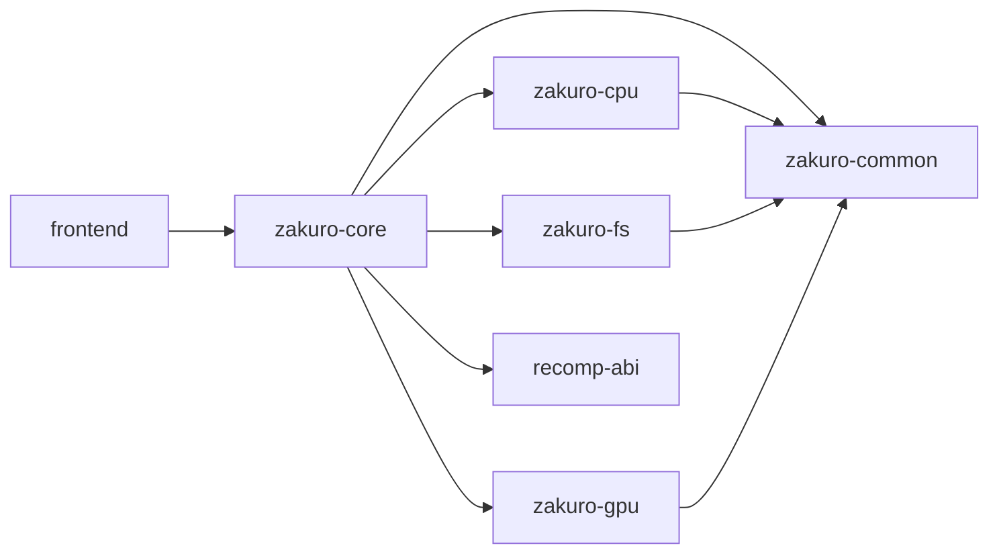
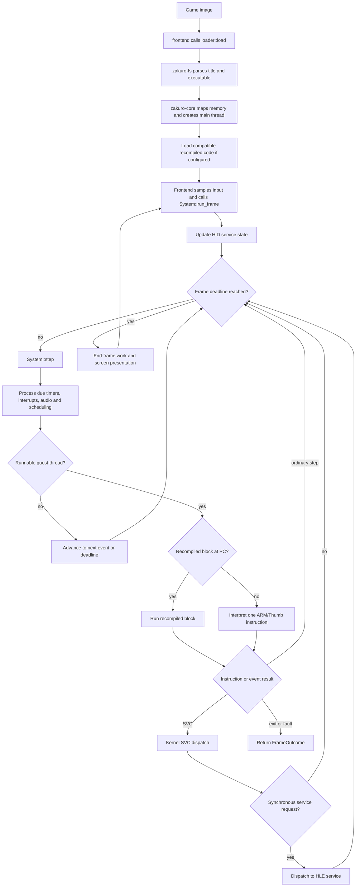

# Engine architecture

The engine is the Zakuro 3DS runtime in `engine/`. Its five crates separate
shared console definitions, title-image parsing, ARM CPU emulation, PICA200 GPU
emulation, and the system that ties them together. The `frontend` crate owns
the host event loop and device I/O; it drives the engine but is not part of
`engine/`.

## Crates

| Crate | Responsibility |
|---|---|
| `zakuro-common` (`engine/common`) | Console models, virtual/physical address types, memory map constants, bit helpers, and result codes shared by the engine. |
| `zakuro-fs` (`engine/fs`) | Reads a game image and parses NCSD, CIA, NCCH, ExeFS, RomFS, and BLZ-compressed code. `Title` exposes the executable and game files without eagerly copying the full ROM. |
| `zakuro-cpu` (`engine/cpu`) | ARM11 ARM/Thumb, VFP, CP15, processor status and register state. Its `Bus` abstraction sends guest memory accesses to the owning system. |
| `zakuro-gpu` (`engine/gpu`) | PICA200 command processing, shaders, texture formats, blending, lighting, rasterization, and screen rendering. It has a software renderer and an optional OpenGL ES renderer (`gles` feature). |
| `zakuro-core` (`engine/core`) | Owns the emulated system state and execution loop: memory, CPU, kernel, services, GPU, renderer, title loader, and optional recompiled-code library. |

The runtime dependency direction is:

`recompiler/` is a separate build-time tool that produces title-specific
native code. At runtime, `zakuro-core` loads compatible code through the ABI;
instructions without a recompiled block use the interpreter.

## Module map

### `zakuro-common`

- `memory_map`: guest address-space constants; `bits`: bit manipulation.
- `result`: emulated result codes and values.
- `lib.rs`: common address types, screen dimensions, and console model.

### `zakuro-fs`

- `cia`, `ncsd`, `ncch`: outer game-image and executable-partition formats.
- `exefs`, `romfs`, `romfs_build`: executable and game-data filesystems.
- `lz77`: decompression of compressed executable code.
- `reader`: bounds-checked binary reading shared by parsers (private module).

### `zakuro-cpu`

- `arm`, `thumb`: ARM and Thumb instruction decoders and execution.
- `vfp`: floating-point/vector instructions; `cp15`: system control and
  identification registers.
- `psr`: processor status, modes, and condition evaluation.
- `lib.rs`: CPU state, instruction stepping, and the `Bus` contract.

### `zakuro-gpu`

- `registers`, `raster`: PICA200 state and drawing pipelines; `raster/gles`
  provides the OpenGL ES path when enabled.
- `shader`: shader instruction set and GLSL generation; `tev`: texture
  environment stages.
- `texture`, `format`, `blend`, `fog`, `lighting`, `proctex`: texture decode
  and the fixed-function graphics operations.
- `renderer`, `journal`, `overlay`: renderer interface, draw tracking, and
  host overlays.
- `lib.rs`: GPU state, guest-memory interface, and renderer exports.

### `zakuro-core`

- `loader`: turns an image into a running `System`, maps executable segments,
  creates the initial thread, and optionally loads recompiled code.
- `memory`: guest virtual mappings, physical memory allocation, memory
  configuration, and fast-memory support.
- `kernel`: SVC dispatch, IPC command buffers, kernel objects and handles,
  synchronization primitives, threads, and scheduling.
- `services`: high-level emulation of console services. Main groups include
  `gsp` (GPU/display), `hid` (input), `fs` (file access), `dsp` (audio),
  `apt` (application lifecycle), `cfg` (configuration), and `srv` (service
  registration), with other service modules alongside them.
- `recompiled`: linked or dynamically loaded recompiled-code libraries;
  `hints`: identifies code that may benefit from recompilation.
- `cro`: dynamic module loading; `replay`: deterministic input/replay support.
- `lib.rs`: `System`, `Config`, `FrameOutcome`, and the central run loop.

## Execution path

In detail:

1. The frontend calls `zakuro_core::loader::load`. The loader uses
   `zakuro_fs::Title::load`, maps the title's text, read-only data, writable
   data, stack, and special memory pages, then creates the main thread from
   the executable header. It attaches recompiled code when configured and
   usable; otherwise execution is interpreted.
2. The frontend translates host controls into `InputState` and calls
   `System::run_frame`. The core updates the emulated HID state and repeatedly
   calls `System::step` until the frame's CPU-cycle deadline.
3. Each step handles due frame, framebuffer-poll, audio, timer, and scheduler
   work before guest execution. If all guest threads are blocked, the core
   advances emulated time to the next event instead of spinning.
4. Guest code runs as a recompiled block when the loaded library has code at
   the current PC; otherwise `zakuro_cpu` executes one instruction against
   `zakuro_core::memory::Memory`. SVC instructions enter `kernel::svc`; IPC
   requests are routed by `services::handle_request` to the matching HLE
   service.
5. GSP service activity submits GPU work and reports framebuffer changes.
   `zakuro_gpu` reads and writes guest memory through its `GpuMemory`
   interface and renders through the configured `Renderer`. At the frame
   boundary the core completes GPU frame work and exposes screens and audio
   for the frontend to present or play.
6. `run_frame` returns `Completed`, `Exited`, or `Faulted`. The frontend owns
   host pacing, presentation, sound output, and its menu; it then begins the
   next frame unless the title stopped.

The frame deadline is based on 60 Hz (`CYCLES_PER_FRAME`). Framebuffer
completion is polled during execution so finished images can be submitted
without waiting for the next frame boundary; VBlank and other scheduled events
still follow emulated CPU time.

## GLES render resolution

The frontend's Resolution setting selects the GLES drawing scale, from 0.5x
through 3.5x in quarter-step increments. It takes effect the next time a game
starts. The renderer sizes its draw surfaces to that scale while preserving
native-size guest images and memory layout; scaled surfaces pass through a
native-size twin when guest-visible pixels must be read back.

Eligible texture copies and display transfers can remain on the GPU at
sub-native scales. Mixed transfers also scale their dispatch dimensions and
shared row boundaries so adjacent memory-backed and drawn regions stay
contiguous. Transfers with flipped or linear input, column offsets, retiled
memory gaps, overdrawn textures, or format reinterpretation may still use the
CPU path.

## Useful entry points

- Title loading: [`engine/core/src/loader.rs`](../engine/core/src/loader.rs)
- System state and frame loop: [`engine/core/src/lib.rs`](../engine/core/src/lib.rs)
- Kernel and scheduling: [`engine/core/src/kernel/mod.rs`](../engine/core/src/kernel/mod.rs)
- Service dispatch: [`engine/core/src/services/mod.rs`](../engine/core/src/services/mod.rs)
- CPU state and bus contract: [`engine/cpu/src/lib.rs`](../engine/cpu/src/lib.rs)
- GPU state and renderer interface: [`engine/gpu/src/lib.rs`](../engine/gpu/src/lib.rs)
- Image parsing and `Title`: [`engine/fs/src/lib.rs`](../engine/fs/src/lib.rs)